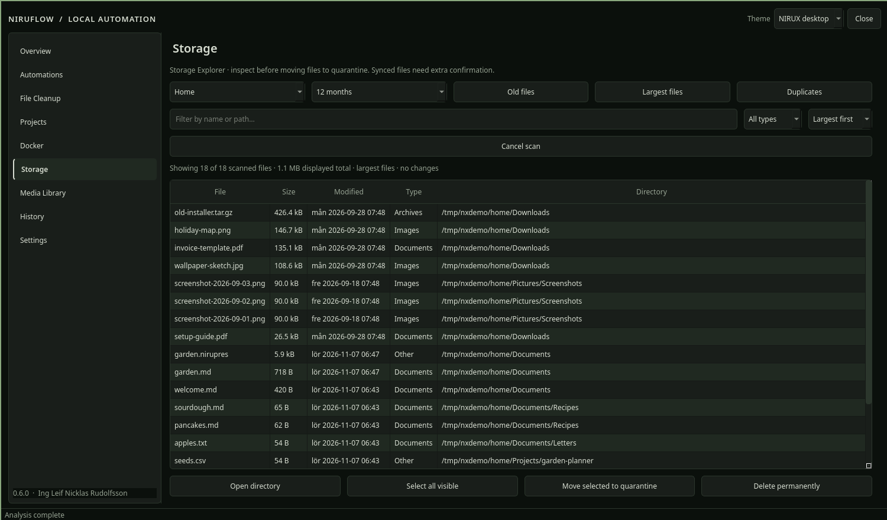

# NIRUFLOW

Local-first maintenance cockpit for file cleanup, storage review, projects and Docker.

**Status: alpha** · Part of the [NIRUX](https://github.com/nirucon/nirux) suite · [MIT License](LICENSE)



## About

NIRUFLOW is where I tidy up my machines: old downloads and screenshots,
large and duplicate files, forgotten files, project artifacts and Docker
leftovers. It has a desktop window (PySide6) and a command line that prints
JSON.

It keeps destructive work explicit. Scans are read-only, removals need
confirmation, and cleanup moves files to a quarantine you can restore from
instead of deleting them. Synced folders (Nextcloud and friends) get an extra
guard, because a move there can synchronize as a deletion on every other
device. No cloud service, account or background daemon is needed.

It is a NIRU app first and a NIRUX extra second; inside NIRUX it follows the
active NIRUWM theme.

## Features

- **Cleanup rules** (for example Downloads and Screenshots older than N
  hours), with protected names (`Important`, `Fun`, `SAVE` by default),
  quarantine and restore. Rules are disabled by default.
- **Storage:** inventory, duplicate detection, large files, forgotten files
  and permanent deletion with content verification.
- **Projects:** read-only inventory of project artifacts and patch chains.
- **Docker:** containers, images, Compose discovery and image-cleanup
  previews.
- **Doctor** and read-only maintenance insights.
- Portable location profiles per machine, and configuration backup
  export/import.
- Optional hourly systemd user timer for rules marked automatic.
- English UI with Swedish, UK or US date/time formatting.
- **NIRUX desktop** theme: follows the active NIRUWM theme live, including a
  custom `~/.config/niruwm/themes/NAME.toml`; Niru Noir, Satie and C. Larsson
  are available as fixed themes.

## Requirements

- Linux with Python 3.10+, `venv` and `pip` (on Debian: `python3-venv`).
  Works on Debian, Arch and Void.
- Network access on install: PySide6 (6.x) is installed from PyPI into a
  private virtual environment.
- Optional: Docker for the Docker views; systemd for the scheduler (on Void
  or other non-systemd systems, schedule `niruflow run-enabled` with cron or
  runit yourself).

## Installation

### With NIRUX

NIRUFLOW is an optional extra, not part of a normal `nirux install`:

```sh
nirux extras install niruflow
nirux extras update            # later: update selected extras to the pinned version
```

NIRUX downloads the pinned release tag, verifies its SHA-256 and runs the
project's own `install.sh`.

### Standalone

Download and extract a release (or clone the repository), then:

```sh
bash ./install.sh
~/.local/bin/niruflow
```

The installer creates a virtual environment in
`~/.local/share/niruflow/versions/VERSION/venv`, installs NIRUFLOW with its
desktop extra, checks the version and that the GUI imports, then atomically
points `~/.local/share/niruflow/current` at the new version and links
`~/.local/bin/niruflow`. Older versions, configuration, history and
quarantine are kept.

To run selected rules every hour (systemd user timer):

```sh
bash ./install-scheduler.sh
```

## Usage

`niruflow` (or `niruflow desktop`) opens the window. The command line:

```sh
niruflow status                  # version and rule counts
niruflow rules                   # configured rules
niruflow scan RULE               # dry run: what a rule would move
niruflow run RULE                # same dry run
niruflow run RULE --apply        # quarantine the candidates (rule must be enabled)
niruflow run RULE --apply --allow-synced   # ... also inside a synced folder
niruflow restore ID              # restore a quarantined item from history
niruflow history
niruflow run-enabled             # what the timer runs: enabled automatic rules, synced paths skipped
niruflow scheduler-status
niruflow large-files
niruflow forgotten [--months 12] [--limit 100]
niruflow projects [--keep 2]
niruflow media
niruflow locations
niruflow profile
niruflow docker
niruflow docker-containers [--short]
niruflow docker-cleanup-preview [--days 30] [--include-unused]
niruflow compose
niruflow doctor
niruflow backup-export DESTINATION
niruflow backup-import SOURCE
niruflow --version
```

Output is JSON, so it pipes well into `jq`.

## Configuration

Settings are edited in the window and stored in
`~/.config/niruflow/config.json`: language and date/time format, theme,
quarantine retention (`quarantine_days`, default 30), cleanup rules (`path`,
`hours`, `recursive`, `enabled`, `automatic`), protected names, the project
path and per-machine location profiles. `niruflow backup-export` and
`backup-import` move a configuration between machines.

## Files and paths

| Path | Purpose |
|---|---|
| `~/.local/bin/niruflow` | Launcher (symlink into the active venv) |
| `~/.local/share/niruflow/versions/VERSION/` | Installed versions with their venv; `current` points to the active one |
| `~/.config/niruflow/config.json` | Configuration |
| `~/.local/state/niruflow/history.sqlite3` | Action history (used by `restore`) |
| `~/.local/state/niruflow/quarantine/` | Quarantined files |
| `~/.config/systemd/user/niruflow.{service,timer}` | Optional scheduler units |

## Troubleshooting

- **"Quarantine must be on same filesystem for atomic moves".** Quarantine
  uses atomic moves, so a rule's folder must be on the same filesystem as
  `~/.local/state/niruflow/quarantine/`.
- **"Synced location requires explicit --allow-synced confirmation".**
  Intentional: Nextcloud, ownCloud, Dropbox, OneDrive, Google Drive, MEGAsync,
  pCloud, iCloud Drive, Seafile, Syncthing and rclone roots are protected. The
  scheduler always skips them.
- **A deletion is blocked.** A changed inode, device, timestamp or content
  fingerprint blocks deletion on purpose. Files up to 64 MiB get a full
  SHA-256; larger files a bounded first/last-block fingerprint. Directories,
  symlinks and hard-linked files are never deleted through the storage tools.
- `niruflow doctor` summarises the environment.

## Uninstall

There is no uninstall script. To remove NIRUFLOW:

```sh
systemctl --user disable --now niruflow.timer 2>/dev/null
rm -f ~/.config/systemd/user/niruflow.service ~/.config/systemd/user/niruflow.timer
rm -f ~/.local/bin/niruflow ~/.local/share/applications/niruflow.desktop \
      ~/.local/share/icons/hicolor/scalable/apps/niruflow.svg
rm -rf ~/.local/share/niruflow
```

Check `~/.local/state/niruflow/quarantine/` for files you want back before
removing `~/.local/state/niruflow` and `~/.config/niruflow`.

## Building from source

There is nothing to compile. The CI checks:

```sh
python -m compileall -q niruflow
python -m unittest discover -s tests -v
QT_QPA_PLATFORM=offscreen NIRUFLOW_SMOKE=1 timeout 20 python -m niruflow desktop
```

See [CONTRIBUTING.md](CONTRIBUTING.md), [SECURITY.md](SECURITY.md),
[ROADMAP.md](ROADMAP.md) and [RELEASE-NOTES.md](RELEASE-NOTES.md).

## Status, disclaimer and how it's made

**Status: alpha.** The scans and safety checks work and are tested, but I still call it experimental: review every destructive action yourself, especially inside synchronized folders.

NIRUX and every niru* project are made by me, Nicklas Rudolfsson
([@nirucon](https://github.com/nirucon)), for me. They are tailored to my own
needs, preferences and workflows, on my own machines. If they fit yours too,
that's a nice bonus.

- **Free and open source.** Anyone is free to use, study, change and share
  it under the [MIT License](LICENSE).
- **No guarantees.** There is no warranty of any kind. Use it at your own
  risk, read what you install and keep backups of anything that matters.
- **How it's made.** Some of these projects I built from scratch by hand. In
  more recent releases I have used Claude, Anthropic's AI, to do much of the
  heavy lifting under my direction: I decide what to build and how it should
  behave, and I test it on my own machines. It saves me a lot of time, and
  the result is quite OK.
- **Alpha, beta, dev, and maybe forever.** Most things here are alpha, beta
  or dev, and may stay that way. Maybe one day there will be a real stable
  release, but given how fast development moves, and how I am as a person,
  maybe never :)

| Label | Meaning |
|---|---|
| dev | Under active construction; may not build, install or work yet. |
| alpha | Works on my machines, but incomplete or rough; expect breaking changes. |
| beta | In daily use on my machines and mostly complete; rough edges remain. |

## License

MIT License, see [LICENSE](LICENSE). Copyright (c) 2026 Ing Leif Nicklas Rudolfsson.
