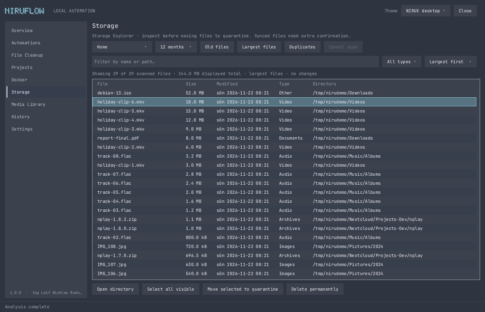

# NIRUFLOW

Local-first maintenance cockpit for file cleanup, storage review, projects and Docker.

**Status: alpha** · Part of the [NIRUX](https://github.com/nirucon/nirux) suite · [MIT License](LICENSE)



## About

NIRUFLOW is where I tidy up my machines: old downloads and screenshots,
large and duplicate files, forgotten files, project artifacts and Docker
leftovers. It has a desktop window and a command line that prints JSON.
Since 1.0.0 it is a single Rust binary: an X11 window drawn on its own
canvas (no Qt, GTK or web engine) and parallel scans that never block the
window.

It keeps destructive work explicit. Scans are read-only, removals need
confirmation, and cleanup moves files to a quarantine you can restore from
instead of deleting them. Synced folders (Nextcloud and friends) get an extra
guard, because a move there can synchronize as a deletion on every other
device. No cloud service, account or background daemon is needed.

It is a NIRU app first and a NIRUX extra second; inside NIRUX it follows the
active NIRUWM theme.

## Features

- **Cleanup rules** (for example Downloads and Screenshots older than N
  hours), with protected names (`Important`, `Fun`, `SAVE` by default),
  quarantine and restore. Rules are disabled by default.
- **Storage:** inventory, duplicate detection, large files, forgotten files
  and permanent deletion with content verification.
- **Projects:** read-only inventory of project artifacts and patch chains.
- **Docker:** containers, images, Compose discovery and image-cleanup
  previews.
- **Doctor** and read-only maintenance insights.
- Portable location profiles per machine, and configuration backup
  export/import.
- Optional hourly systemd user timer for rules marked automatic.
- English UI with Swedish, UK or US date/time formatting.
- **NIRUX desktop** theme: follows the active NIRUWM theme live, including a
  custom `~/.config/niruwm/themes/NAME.toml`; Niru Noir, Satie and C. Larsson
  are available as fixed themes.

## Requirements

- Linux on x86_64 with X11 (under Wayland through XWayland). The release
  binary is static (musl), so there is nothing else to install; fonts come
  from fontconfig (`fc-match`), with DejaVu Sans Mono as the fallback.
- `curl` or `wget` and `sha256sum` for the installer to fetch the release.
- Optional: Docker for the Docker views; systemd for the scheduler (on Void
  or other non-systemd systems, schedule `niruflow run-enabled` with cron or
  runit yourself); `xdg-open` for "Open directory".
- To build from source: Rust 1.82 or newer and a C compiler (SQLite is
  built in).

## Installation

### With NIRUX

NIRUFLOW is an optional extra, not part of a normal `nirux install`:

```sh
nirux extras install niruflow
nirux extras update            # later: update selected extras to the pinned version
```

NIRUX downloads the pinned release tag, verifies its SHA-256 and runs the
project's own `install.sh`. In NIRUX, `nirux manual niruflow` opens the
short tour in the NIRUX manual.

### Standalone

Download and extract a release (or clone the repository), then:

```sh
./install.sh              # the prebuilt binary of this version, SHA-256 verified
./install.sh --build      # or build it here with cargo
~/.local/bin/niruflow
```

The installer puts the binary in `~/.local/bin/niruflow` with a desktop
entry and an icon. It replaces a 0.x Python installation: the old
virtual environments in `~/.local/share/niruflow` and the launcher symlink
go, and an installed scheduler unit is pointed at the new binary.
Configuration, history and quarantine are never touched, and 1.0.0 reads
them unchanged (the same `config.json`, `history.sqlite3` and backup ZIP
format).

To run selected rules every hour (systemd user timer):

```sh
bash ./install-scheduler.sh
```

## Usage

`niruflow` (or `niruflow desktop`) opens the window. The command line:

```sh
niruflow status                  # version and rule counts
niruflow rules                   # configured rules
niruflow scan RULE               # dry run: what a rule would move
niruflow run RULE                # same dry run
niruflow run RULE --apply        # quarantine the candidates (rule must be enabled)
niruflow run RULE --apply --allow-synced   # ... also inside a synced folder
niruflow restore ID              # restore a quarantined item from history
niruflow history
niruflow run-enabled             # what the timer runs: enabled automatic rules, synced paths skipped
niruflow scheduler-status
niruflow large-files
niruflow forgotten [--months 12] [--limit 100]
niruflow projects [--keep 2]
niruflow media
niruflow locations
niruflow profile
niruflow docker
niruflow docker-containers [--short]
niruflow docker-cleanup-preview [--days 30] [--include-unused]
niruflow compose
niruflow doctor
niruflow backup-export DESTINATION
niruflow backup-import SOURCE
niruflow --version
```

Output is JSON, so it pipes well into `jq`. The JSON is the same as in
0.x (layout, key order and number format), so existing scripts keep
working. `doctor` reports `"not required"` for `python` and `pyside6` and
adds the `niruflow` version. Two results are better than before:
`large-files` no longer stops after 20,000 files per location and lists a
file once even when locations overlap (home and `~/Nextcloud`), and
`forgotten` returns the oldest files instead of the first ones found.
(`projects` failed in 0.6.1 and works again.)

### Keys

| Key | Action |
|---|---|
| Ctrl+1 ... Ctrl+9, Alt+1 ... Alt+9 | Pages |
| Ctrl+PageUp / Ctrl+PageDown | Previous / next page |
| Tab / Shift+Tab | Move between the page's fields and table |
| Up, Down, PageUp, PageDown, Home, End | Move in a table (Shift extends) |
| Ctrl+A | Select all rows |
| Ctrl+C | Copy the selected rows (tab separated) |
| Ctrl+F | Focus the page's filter |
| Menu, Shift+F10 | Storage context menu (also right click) |
| F5 | Refresh the page |
| Enter / Escape | Confirm / cancel a dialog (Yes/No dialogs default to No) |
| Ctrl+Q, Ctrl+W | Close |

Folder and file choices use a built-in browser: type a path, or click
(double-click opens a folder); Ctrl+H shows hidden folders.

## Configuration

Settings are edited in the window and stored in
`~/.config/niruflow/config.json`: language and date/time format, theme,
quarantine retention (`quarantine_days`, default 30), cleanup rules (`path`,
`hours`, `recursive`, `enabled`, `automatic`), protected names, the project
path and per-machine location profiles. `niruflow backup-export` and
`backup-import` move a configuration between machines.

## Files and paths

| Path | Purpose |
|---|---|
| `~/.local/bin/niruflow` | The program (one static binary) |
| `~/.config/niruflow/config.json` | Configuration |
| `~/.local/state/niruflow/history.sqlite3` | Action history (used by `restore`) |
| `~/.local/state/niruflow/quarantine/` | Quarantined files |
| `~/.config/systemd/user/niruflow.{service,timer}` | Optional scheduler units |

## Troubleshooting

- **"Quarantine must be on same filesystem for atomic moves".** Quarantine
  uses atomic moves, so a rule's folder must be on the same filesystem as
  `~/.local/state/niruflow/quarantine/`.
- **"Synced location requires explicit --allow-synced confirmation".**
  Intentional: Nextcloud, ownCloud, Dropbox, OneDrive, Google Drive, MEGAsync,
  pCloud, iCloud Drive, Seafile, Syncthing and rclone roots are protected. The
  scheduler always skips them.
- **A deletion is blocked.** A changed inode, device, timestamp or content
  fingerprint blocks deletion on purpose. Files up to 64 MiB get a full
  SHA-256; larger files a bounded first/last-block fingerprint. Directories,
  symlinks and hard-linked files are never deleted through the storage tools.
- `niruflow doctor` summarises the environment.

## Uninstall

```sh
nirux extras uninstall niruflow     # with NIRUX
./uninstall.sh                      # standalone, from a checkout
./uninstall.sh --purge              # also delete rules, history and quarantine
```

A normal uninstall disables the scheduler timer and removes it, the binary,
the desktop entry, the icon and any leftover 0.x installation. Your rules and
history in `~/.config/niruflow` and `~/.local/state/niruflow` are kept. Check
`~/.local/state/niruflow/quarantine/` for files you want back before purging.

## Building from source

```sh
cargo build --release      # target/release/niruflow
./install.sh --build       # build and install
```

The checks CI runs:

```sh
cargo fmt --check
cargo clippy --all-targets -- -D warnings
cargo test
sh tests/xvfb.sh target/release/niruflow     # private Xvfb: first frame, memory, idle CPU, main flows
sh tests/scripts.sh target/release/niruflow  # installer upgrade from 0.x and uninstaller
```

## Performance

Measured on othala (12 threads, NVMe) in the same private Xvfb, 0.6.1
(Python, PySide6) against 1.0.0:

| | 0.6.1 | 1.0.0 |
|---|---|---|
| Window shown (time until mapped) | 530 ms (1,010 ms cold) | 32 to 78 ms |
| First frame drawn (own timing) | | 11 to 40 ms |
| Memory (RSS, idle window) | 90 MB | 13 MB |
| Idle CPU | 0 ticks in 10 s | 0 ticks in 10 s (sleeps in poll) |
| `large-files` on a real home | 128 s | 0.6 s (0.1 s cached) |
| `forgotten --months 12` | 0.41 s | 0.035 s |
| `media` | 44 ms | 2 ms |

Scans run on worker threads with a parallel directory walk, so the window
stays responsive and a storage scan can be cancelled at any time.

See [CONTRIBUTING.md](CONTRIBUTING.md), [SECURITY.md](SECURITY.md),
[ROADMAP.md](ROADMAP.md) and [RELEASE-NOTES.md](RELEASE-NOTES.md).

## Status, disclaimer and how it's made

**Status: alpha.** The scans and safety checks work and are tested, but I still call it experimental: review every destructive action yourself, especially inside synchronized folders.

NIRUX and every niru* project are made by me, Nicklas Rudolfsson
([@nirucon](https://github.com/nirucon)), for me. They are tailored to my own
needs, preferences and workflows, on my own machines. If they fit yours too,
that's a nice bonus.

- **Free and open source.** Anyone is free to use, study, change and share
  it under the [MIT License](LICENSE).
- **No guarantees.** There is no warranty of any kind. Use it at your own
  risk, read what you install and keep backups of anything that matters.
- **How it's made.** Some of these projects I built from scratch by hand. In
  more recent releases I have used Claude, Anthropic's AI, to do much of the
  heavy lifting under my direction: I decide what to build and how it should
  behave, and I test it on my own machines. It saves me a lot of time, and
  the result is quite OK.
- **Alpha, beta, dev, and maybe forever.** Most things here are alpha, beta
  or dev, and may stay that way. Maybe one day there will be a real stable
  release, but given how fast development moves, and how I am as a person,
  maybe never :)

| Label | Meaning |
|---|---|
| dev | Under active construction; may not build, install or work yet. |
| alpha | Works on my machines, but incomplete or rough; expect breaking changes. |
| beta | In daily use on my machines and mostly complete; rough edges remain. |

## License

MIT License, see [LICENSE](LICENSE). Copyright (c) 2026 Ing Leif Nicklas Rudolfsson.
